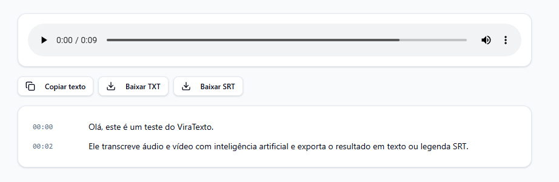
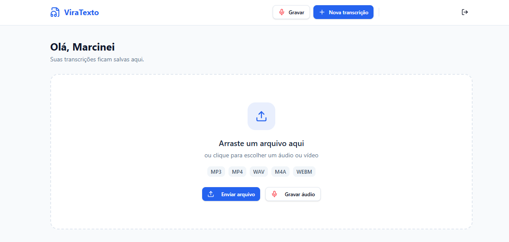

# ViraTexto

Plataforma de transcrição de áudio e vídeo com IA. Converte arquivos de mídia em texto com identificação de falantes, timestamps e suporte a múltiplos idiomas.

**[Acessar o ViraTexto](https://viratexto-gamma.vercel.app)**





## Funcionalidades

- Upload de arquivos de áudio e vídeo (MP3, MP4, WAV, M4A, WEBM e outros)
- Gravação direto pelo microfone do navegador
- Suporte a múltiplos idiomas: Português (BR), Inglês, Espanhol, Francês, Alemão, Italiano e detecção automática
- Identificação de falantes em conversas
- Exportação em TXT e SRT (legenda com timestamps)
- Atualizações em tempo real via WebSocket durante o processamento
- Otimização automática de áudio no cliente para arquivos maiores que 20MB
- Painel administrativo com análise de uso

## Stack

- **Frontend:** React 19 + TypeScript
- **Framework full-stack:** TanStack Start + TanStack Router
- **Deploy:** Vercel (via Nitro)
- **Banco de dados e autenticação:** Supabase (PostgreSQL, Auth, Storage, Realtime)
- **IA:** OpenAI Whisper (via Supabase Edge Functions)
- **Estilização:** Tailwind CSS 4 + Radix UI + Shadcn/UI
- **Build:** Vite 7

## Configuração

### Variáveis de ambiente

Crie um arquivo `.env` na raiz do projeto com as seguintes variáveis:

```env
# Frontend
VITE_SUPABASE_PROJECT_ID=seu_project_ref
VITE_SUPABASE_URL=https://seu_project_ref.supabase.co
VITE_SUPABASE_PUBLISHABLE_KEY=sua_anon_key

# Servidor
SUPABASE_URL=https://seu_project_ref.supabase.co
SUPABASE_PUBLISHABLE_KEY=sua_anon_key
SUPABASE_SERVICE_ROLE_KEY=sua_service_role_key
```

### Secrets da Edge Function

```bash
supabase secrets set SUPABASE_URL=...
supabase secrets set SUPABASE_ANON_KEY=...
supabase secrets set SUPABASE_SERVICE_ROLE_KEY=...
supabase secrets set OPENAI_API_KEY=...
```

## Desenvolvimento

```bash
# Instalar dependências
npm install

# Iniciar em modo desenvolvimento
npm run dev
```

A aplicação estará disponível em `http://127.0.0.1:8080`.

## Build e deploy

```bash
# Build de produção
npm run build

# Preview do build
npm run preview
```

## Arquitetura

### Pipeline de transcrição

1. O cliente faz upload do arquivo para o Supabase Storage (bucket `audio-files`, isolado por usuário)
2. Cria registro na tabela `transcriptions` com status `pending`
3. Edge Function `transcribe` é chamada pelo servidor
4. A função baixa o arquivo, otimiza se necessário, e chama a API Whisper da OpenAI
5. O resultado é salvo com segmentos, falantes, duração e status final
6. O cliente recebe atualização via Supabase Realtime e exibe o resultado

### Estrutura do projeto

```
src/
  routes/          # Páginas (home, auth, detalhes de transcrição, admin)
  components/      # Componentes UI (TranscribeModal, RecordModal, etc.)
  integrations/
    supabase/      # Cliente do banco e middleware de auth
  functions/       # Funções server-side (dados do painel admin)

supabase/
  functions/
    transcribe/    # Edge Function de integração com OpenAI
  migrations/      # Schema do banco e políticas RLS
```

### Banco de dados

- **transcriptions:** Metadados, texto completo, segmentos com timestamps, informações de falantes e status
- **profiles:** Dados do usuário (criado automaticamente pelo auth do Supabase)
- RLS ativo: usuários acessam apenas seus próprios dados
- Realtime habilitado na tabela `transcriptions`

## Licença

Todos os direitos reservados.
